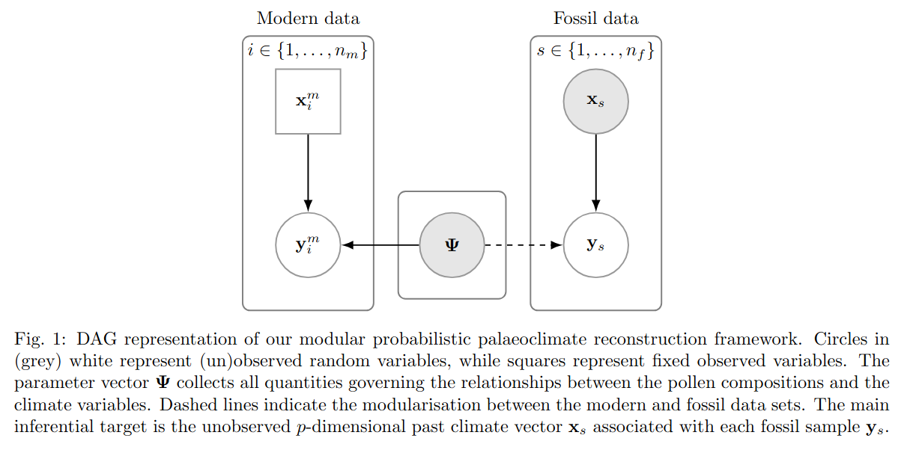
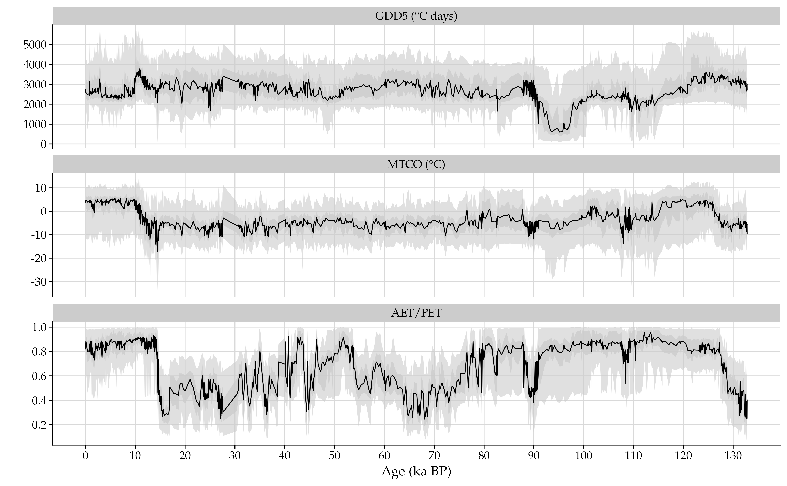
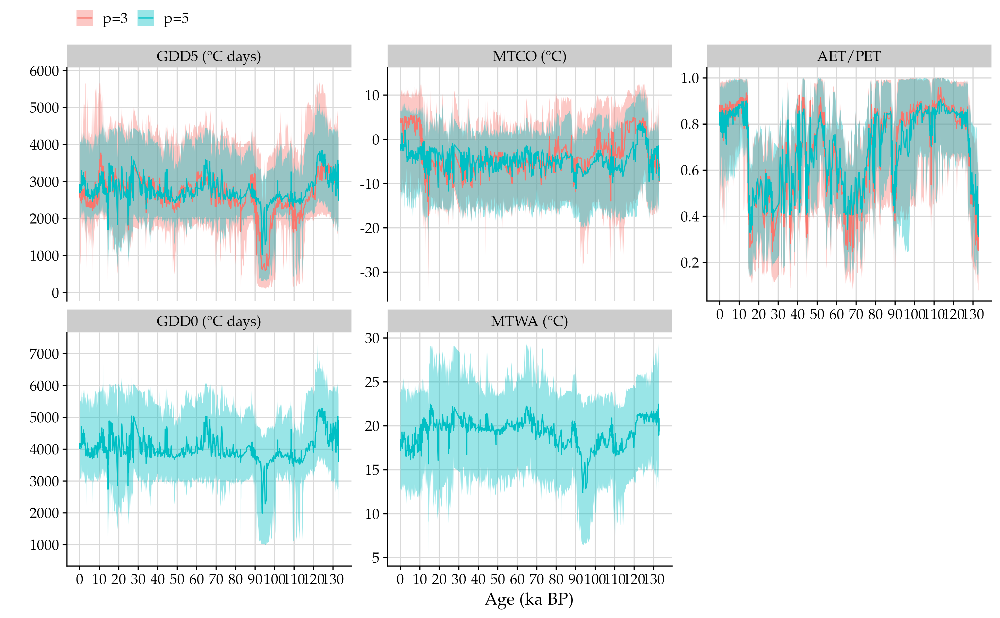

```{r setup, include = FALSE}
knitr::opts_chunk$set(fig.width = 7, fig.height = 5, fig.align = "center", 
                      fig.show = "hold", warning = FALSE,
                      out.width = "90%",
                      message = FALSE, progress = FALSE, 
                      collapse = TRUE, comment = "#>",
                      dev.args = list(family = "Palatino"))
library(ggplot2)
library(cowplot)
theme_set(
  theme_cowplot(font_size = 16, font_family = "Palatino") +
    background_grid() +
    theme(text = element_text(family = "Palatino", size = 16),
          legend.position = "top")
)
r_outputs <- readRDS(file = "r_outputs_palaeoclimate.rds")
```

# Introduction

The goal of this vignette is to demonstrate how one can use the `zanicc` 
package to perform pollen-based palaeoclimate reconstruction using the Bayesian 
modular framework developed by
[Menezes et al. (2026b)](https://arxiv.org/abs/2609.08866).
The underlying generative model assumed for how the pollen compositions depend on
the climate covariates is the ZANIM-LN-BART model introduce by 
[Menezes et al. (2026)](https://arxiv.org/abs/2601.08067v2).
We adopt such model, because it respects the compositional nature of the pollen
counts and provides substantial
flexibility to capture complex features present in the modern data set.

Figure 1 extracted from [Menezes et al. (2026b)](https://arxiv.org/abs/2609.08866)
provides a simplified representation of the proposed modular framework,
in the form of a directed acyclic graph (DAG).
We highlight three main features.
First, it respects the ecological causal relationship that compositional counts
$\mathbf{y}_i^m$ and $\mathbf{y}_s$ are affected by their corresponding 
climate covariates (drivers) $\mathbf{x}_i^m$ and $\mathbf{x}_s$.
Second, we assume a common set of parameters $\boldsymbol{\Psi}$ governing theses 
pollen-climate relationships for both the modern and fossil data sets. 
Finally, the dashed lines connecting the model parameters,
$\boldsymbol{\Psi}$, to the fossil pollen counts, $\mathbf{y}_s$,
indicate that a modularisation occurs.

```{r dag-paleo, echo=FALSE}

```

Modularisation means that the underlying Bayesian model for pollen-based 
climate reconstruction is made of two modules: 
(i) the **forward** module, which estimate
the parameters $\boldsymbol{\Psi}$ governing the pollen-climate relationships,
given the modern data $\{\mathbf{x}^m_i, \mathbf{y}_i^m\}$;
and
(ii) the **reconstruction** module, which infer the missing past climate 
$\mathbf{x}_s$ given the corresponding observed fossil pollen counts
$\mathbf{y}_s$, and the estimated parameters $\boldsymbol{\Psi}$.
From a computational point of view, Bayesian inference for the parameters 
$\boldsymbol{\Psi}$, and the past climate $\mathbf{y}_s$ can be performed in two
sequential stages.

# Data sets

A typical pollen-based palaeoclimate reconstruction problem consist of two data
sources.
A modern calibration data set, which has information about the pollen 
composition counts and climate covariates at different sample locations.
The modern data set used in our paper is available in the `zanicc` package, and
can be loaded in R as follows
```{r modern-data}
library(zanicc)
data(pollen_climate, package = "zanicc")
str(pollen_climate)
dim(pollen_climate$Y)
```

In addition, there would be a fossil data set, which includes information only 
about the pollen composition counts typically obtained for a single site (location)
at different core depths.
The fossil data set used in our paper
are fossil pollen records from _Lago Grande di Monticchio_ (LGdM),
a lake situated in the crater of Monte Vulture in Basilicata,
southern Italy.
This data is also available in the `zanicc`, and can be loaded in R as follows:
```{r fossil-data}
data(pollen_monticchio, package = "zanicc")
str(pollen_monticchio)
```

Importantly, both, the modern and fossil data must contain composition 
counts for the same set of pollen taxa.
In our analysis, there are $d=28$ pollen taxa.
```{r check-same-taxa}
all.equal(colnames(pollen_climate$Y), colnames(pollen_monticchio))
```

For a detailed analysis using the full data sets, we refer to
[Menezes et al. (2026b)](https://arxiv.org/abs/2609.08866), and the accompanying
Github repository
[AndrMenezes/reproduce__palaeoclimate_zanim_ln_bart](https://github.com/AndrMenezes/reproduce__palaeoclimate_zanim_ln_bart/),
which contains scripts to reproduce all analyses and simulations in the paper.
Here, for illustrative purposes we will focus on subsets of both data sets.

```{r subset}
set.seed(1212)
n_sample <- 1000L
ids <- sample.int(n = nrow(pollen_climate$Y), size = n_sample, replace = FALSE)
Y_modern <- pollen_climate$Y[ids, ]
X_modern <- pollen_climate$X[ids, c("gdd5", "mtco", "aet.pet")]
pollen_names <- colnames(Y_modern)
```


# Forward module

In the forward module, we estimate the parameters $\boldsymbol{\Psi}$ that governs
the pollen-climate relationships under the ZANIM-LN-BART model.
In essence, this means to run our efficient MCMC algorithm as discussed in the
[vignette]() about the regression models for count-compositional data.

As in the other [vignette](), we use a small number of iterations as well as 
category-specific regression trees.

```{r settings}
NSKIP <- 1000L
NDPOST <- 1000L
NTREES <- 20L
```

The implementation of the modular framework requires to save the posterior draws of
$\boldsymbol{\Psi}$, that is, to save the posterior draws of the regression 
trees ensembles in some folder.
This would be used to obtain the climate reconstructions.
The code below fit the ZANIM-LN-BART and save the posterior draws in the folder 
`forests`.
We also save the model object in the root folder using the function [save_model()]().

```{r forward-module, eval=FALSE}
dir_forests <- "./forests"
if (!file.exists(dir_forests)) dir.create(dir_forests)
zanim_ln_bart <- zanicc(Y = Y_modern, X_count = X_modern, X_zi = X_modern,
                        model = "zanim_ln_bart", ntrees_theta = NTREES,
                        ntrees_zeta = NTREES, ndpost = NDPOST,
                        nskip = NSKIP, keep_draws = FALSE,
                        save_trees = TRUE, forests_dir = dir_forests)
save_model(object = zanim_ln_bart, model_dir = "./", file_name = "zanim_ln_bart.rds")
```

# Reconstruction module

In the reconstruction module, we invert the pollen-climate relationships given 
the fossil counts from the Monticchio site and the posterior draws of the
parameter $\boldsymbol{\Psi}$.
In essence, this means to compute the inverse posterior distribution of the
past climate variables.
Importantly, the modular nature of our approach facilitates that the parameters of
ZANIM-LN-BART model, $\boldsymbol{\Psi}$, can be inferred only once using the
modern data.
Hence, one could obtain reconstructions for different fossil samples for which
pollen counts are available for the same taxa as in our modern calibration data set.

The function [inverse_posterior_zanimlnbart()]() implements three different sampling
schemes to approximate the posterior distribution of the past climate.
Its first argument is the the model object `zanim_ln_bart` which we save in 
the previous Section.

To load this object, we can use
```{r load-forward-module, eval=FALSE}
zanim_ln_bart <- load_model(model_dir = "./", file_name = "zanim_ln_bart.rds")
```

The three sampling schemes differs in terms of technique used to approximate the
inverse posterior, but also the assumed prior distribution for the past 
climate.
The default and recommended approach is the sampling importance resampling (SIR),
which assumed an uniform prior over the convex hull of the modern data climate.
The other two are the elliptical slice sampling (ESS) algorithm of 
[Murray et al. (2010)](), which the underlying prior for the past climate vector
is a multivariate normal distribution, and
the constrained ESS (cESS), which is based on a multivariate truncated normal prior
that restricts the underlying prior to the modern climate domain.
Here, we use the SIR algorithm, as its performance was better in several
simulation and validation experiments presented in 
[Menezes et al. (2026b)](https://arxiv.org/abs/2609.08866).

For the SIR algorithm, we first need to generate uniform proposal values
inside the convex hull of the modern data. 
This can be done using the function [runifconvexhull()]() as follows:

```{r proposals, eval=FALSE}
set.seed(1212)
N_PROPOSAL <- 2000L
x_proposal <- runifconvexhull(n = N_PROPOSAL, X = unique(X_modern))
```

The function [inverse_posterior_zanimlnbart()]() can be used to reconstruct the 
three dimension climate vector given the fossil pollen counts from 
Given the proposal values, `x_proposal`, the object `zanim_ln_bart` with information 
about the forward module

We can now reconstruct the past three dimension climate vector given the fossil 
pollen counts of LGdM using the following code:
```{r sir, eval=FALSE}
monticchio_dir <- "./monticchio"
if (!file.exists(monticchio_dir)) dir.create(monticchio_dir)
sir <- inverse_posterior_zanimlnbart(object = zanim_ln_bart,
                                     Y = pollen_monticchio,
                                     x_proposal = x_proposal,
                                     dir_posterior_fx = monticchio_dir,
                                     method = "sir")
saveRDS(sir, file = "sir.rds")
```


In the directory `"./monticchio"`, the posterior predictions of the
ZANIM-LN-BART model at the proposal values are saved in the files `theta_ij` 
and `zeta_ij.bin`.
This is useful when the user want to obtain reconstructions for set of fossil 
pollen counts at different sites using the same proposal values.

We can inspect the time take to compute the posterior predictions of ZANIM-LN-BART 
model using:
```{r elapsed-time-predict, eval=FALSE}
attr(sir, "elapsed_time_predict")[3L]
```
```{r print-elapsed-time-predict, echo=FALSE}
r_outputs$et_predict_p3
```

While the time taken to run the SIR algorithm given the posterior predictions is:
```{r elapsed-time-sir, eval=FALSE}
attr(sir, "elapsed_time")[3L]
```
```{r print-elapsed-time-sir, echo=FALSE}
r_outputs$et_sir_p3
```


Each fossil sample $s\in\{1,\ldots, n_f\}$ in the LGdM site has an associated age in
thousands of years before present, where `present' corresponds to 1950 AD.
This is stored in `attr(pollen_monticchio, "age")`.
We can use this information to visualise the palaeoclimate reconstructions
as time series plots, from youngest to oldest.

```{r plotting-sir-p3, eval=FALSE}
covariates <- c("gdd5", "mtco", "aet.pet")
map_vars <- c("mtco" = "MTCO (°C)", "gdd5" = "GDD5 (°C days)",
              "aet.pet" = "AET/PET")
p <- length(covariates)
age <- attr(pollen_monticchio, "age")
age <- age / 1000L
# Organise data
list_data <- vector(mode = "list", length = p)
for (k in seq_len(p)) {
  post <- sir[, k, ]
  list_data[[k]] <- data.frame(age = age,
                               variable = covariates[k],
                               mean = colMeans(post),
                               median = apply(post, 2, median),
                               lower_95 = apply(post, 2, quantile, probs = 0.025),
                               upper_95 = apply(post, 2, quantile, probs = 0.975),
                               lower_50 = apply(post, 2, quantile, probs = 0.75),
                               upper_50 = apply(post, 2, quantile, probs = 0.25))
}
data_posterior <- do.call(rbind, list_data)
data_posterior$variable <- map_vars[data_posterior$variable]
data_posterior$variable <- factor(data_posterior$variable, 
                                  levels = c("GDD5 (°C days)", "MTCO (°C)",
                                             "AET/PET"))
# Plot
ggplot(data_posterior, aes(x = age, y = median)) +
  facet_wrap(~variable, scales = "free_y", ncol = 1L) +
  geom_ribbon(aes(ymin = lower_95, ymax = upper_95), fill = "grey80", alpha = 0.6) +
  geom_ribbon(aes(ymin = lower_50, ymax = upper_50), fill = "grey80", alpha = 0.8) +
  geom_line(linewidth = .5) +
  scale_x_continuous(breaks = scales::pretty_breaks(20)) +
  scale_y_continuous(breaks = scales::pretty_breaks(6)) +
  labs(x = "Age (ka BP)", y = "")
```

```{r plot-sir-p3, echo=FALSE}

```


## Reconstructing five climate variables

Using our package it is also possible to reconstruct an arbitrary number of climate 
variables, albeit to increase of computational time.
Here, we will reconstruct $p=5$ climate variables, which is available in the 
modern data set.
For illustrative purposes we will include the GDD0 and MTWA variables,
though they are highly correlated to GDD5 and MTCO, respectively.

We first fit the ZANIM-LN-BART model with the additional climate variables.
```{r forward-module-p5, eval=FALSE}
X_modern_p5 <- pollen_climate$X[ids, c("gdd5", "gdd0", "mtco", "mtwa", "aet.pet")]
dir_forests_p5 <- "./forests_p5"
if (!file.exists(dir_forests_p5)) dir.create(dir_forests_p5)
zanim_ln_bart_p5 <- zanicc(Y = Y_modern, X_count = X_modern_p5, X_zi = X_modern_p5,
                           model = "zanim_ln_bart", ntrees_theta = NTREES,
                           ntrees_zeta = NTREES, ndpost = NDPOST,
                           nskip = NSKIP, keep_draws = FALSE,
                           save_trees = TRUE, forests_dir = dir_forests_p5)
save_model(object = zanim_ln_bart, model_dir = "./",
           file_name = "zanim_ln_bart_p5.rds")
```

We then generate the uniform proposal in the convex hull for $p=5$ climate dimension.
```{r proposals-p5, eval=FALSE}
set.seed(1212)
N_PROPOSAL <- 2000L
x_proposal_p5 <- runifconvexhull(n = N_PROPOSAL, X = unique(X_modern_p5))
```

Next, we run the inverse posterior sampling.
```{r sir-p5, eval=FALSE}
monticchio_p5_dir <- "./monticchio_p5"
if (!file.exists(monticchio_p5_dir)) dir.create(monticchio_p5_dir)
sir_p5 <- inverse_posterior_zanimlnbart(object = zanim_ln_bart_p5,
                                        Y = pollen_monticchio,
                                        x_proposal = x_proposal_p5,
                                        dir_posterior_fx = monticchio_p5_dir,
                                        method = "sir")
saveRDS(sir_p5, file = "sir_p5.rds")
```

As before, we can check the runtime as follows:
```{r elapsed-time-predict-p5, eval=FALSE}
attr(sir_p5, "elapsed_time_predict")[3L]
```
```{r print-elapsed-time-predict-p5, echo=FALSE}
r_outputs$et_predict_p5
```
```{r elapsed-time-sir-p5, eval=FALSE}
attr(sir_p5, "elapsed_time")[3L]
```
```{r print-elapsed-time-sir-p5, echo=FALSE}
r_outputs$et_sir_p5
```

Finally, we can compare the obtained reconstructions using $p=3$ variables against
the reconstructions using $p=5$ climate variables.

```{r plot-sir-p5, echo=FALSE}

```


```{r load-sir-p5, eval=FALSE, echo=FALSE}
sir_p5 <- readRDS(file = "sir_p5.rds")
covariates <- c("gdd5", "gdd0", "mtco", "mtwa", "aet.pet")
map_vars <- c("mtco" = "MTCO (°C)",
              "mtwa" = "MTWA (°C)",
              "gdd5" = "GDD5 (°C days)",
              "gdd0" = "GDD0 (°C days)",
              "aet.pet" = "AET/PET")
p <- length(covariates)
age <- attr(pollen_monticchio, "age")
age <- age / 1000L
# Organise data
list_data <- vector(mode = "list", length = p)
for (k in seq_len(p)) {
  post <- sir_p5[, k, ]
  list_data[[k]] <- data.frame(age = age,
                               variable = covariates[k],
                               mean = colMeans(post),
                               median = apply(post, 2, median),
                               lower_95 = apply(post, 2, quantile, probs = 0.025),
                               upper_95 = apply(post, 2, quantile, probs = 0.975),
                               lower_50 = apply(post, 2, quantile, probs = 0.75),
                               upper_50 = apply(post, 2, quantile, probs = 0.25)
                               )
}
data_posterior_p5 <- do.call(rbind, list_data)
data_posterior_p5$variable <- map_vars[data_posterior_p5$variable]
data_posterior_p5$variable <- factor(data_posterior_p5$variable,
                                     levels = c("GDD5 (°C days)", "MTCO (°C)",
                                                "AET/PET"))
data_posterior$dim_p <- "p=3"
data_posterior_p5$dim_p <- "p=5"
data_posterior <- rbind(data_posterior, data_posterior_p5)
data_posterior$variable <- factor(data_posterior$variable,
                                  levels = c("GDD5 (°C days)", "MTCO (°C)",
                                             "AET/PET"))
# Plot with ggplot
ggplot(data_posterior, aes(x = age, y = median)) +
  facet_wrap(~variable, scales = "free_y") +
  geom_ribbon(aes(ymin = lower_95, ymax = upper_95, fill = dim_p), alpha = 0.4) +
  geom_line(aes(col = dim_p), linewidth = .5) +
  scale_x_continuous(breaks = scales::pretty_breaks(20)) +
  scale_y_continuous(breaks = scales::pretty_breaks(6)) +
  labs(x = "Age (ka BP)", y = "", col = "", fill = "")
```


# References

Menezes, A. F. B., Parnell, A. C. and Murphy, K. (2026), Bayesian nonparametric models for zero-inflated count-compositional data using ensembles of regression trees. _arXiv preprint_, **arXiv:2601.08067** <https://arxiv.org/abs/2601.08067v2>.

Menezes, A. F. B., Parnell, A. C., Huntley, B. and Murphy, K. (2026b), Bayesian palaeoclimate reconstruction from zero-inflated count-compositional pollen data: A case study of Lago Grande di Monticchio in southern Italy. _arXiv preprint_, **arXiv:2609.08866** <https://arxiv.org/abs/2609.08866>.
