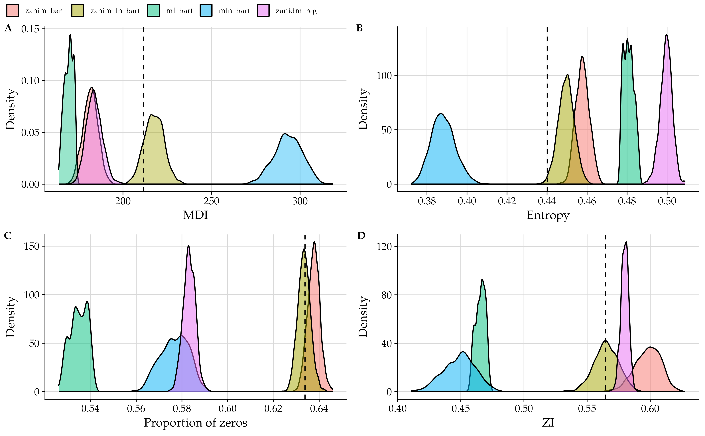
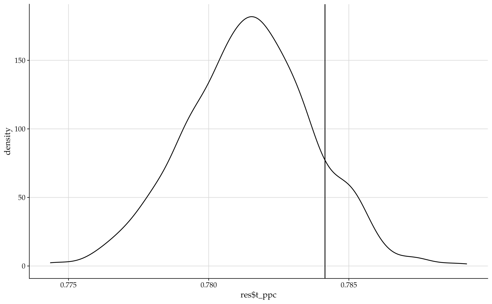
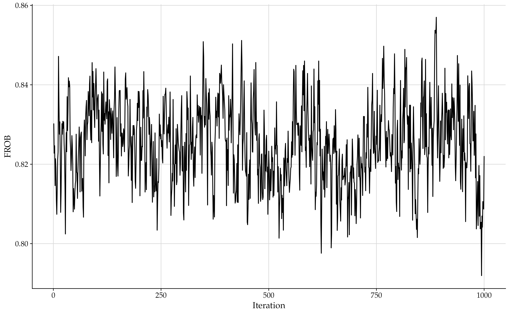
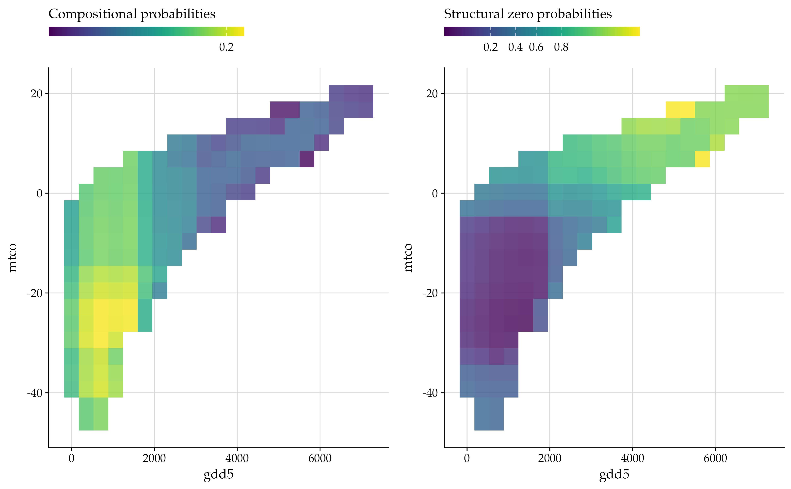

```{r setup, include = FALSE}
knitr::opts_chunk$set(fig.width = 7, fig.height = 5, fig.align = "center", 
                      fig.show = "hold", warning = FALSE,
                      out.width = "90%",
                      message = FALSE, progress = FALSE, 
                      collapse = TRUE, comment = "#>",
                      dev.args = list(family = "Palatino"))
library(zanicc)
library(ggplot2)
library(cowplot)
theme_set(
  theme_cowplot(font_size = 16, font_family = "Palatino") +
    background_grid() +
    theme(text = element_text(family = "Palatino", size = 16),
          legend.position = "top")
)

dir_forests <- "./forests"

# Load capture outputs
r_outputs <- readRDS("./r_outputs.rds")
```


# Introduction

The `zanicc` package provides tools for Bayesian (non)parametric regression
analysis of zero-inflated count-compositional data.
In particular, the package provides functions for performing Bayesian inference 
through efficient Markov chain Monte Carlo (MCMC) algorithms for various 
nonparametric and parametric count-compositional models.

Its primary contribution is the implementation of Bayesian inference schemes
for the ZANIM-BART and ZANIM-LN-BART models developed by
[Menezes et al. (2026)](https://arxiv.org/abs/2601.08067v2).
The package also implements other models, including the ML-BART model of 
[Murray (2021)](https://doi.org/10.1080/01621459.2020.1813587)
and the ZANIDM (ZIDM) linear regression model of
[Koslovsky (2023)](https://doi.org/10.1111/biom.13853).
We stress that the ML-BART model was introduced by
[Murray (2021)](https://doi.org/10.1080/01621459.2020.1813587) in the context of multiclass classification problems; in this package, it can be employed with arbitrary numbers of sample-specific trials. 
Another extension of ML-BART incorporating logistic-normal random effects, MLN-BART, is also provided.

The nonparametric models available in `zanicc` use ensembles of regression
trees through appropriate Bayesian additive regression trees (BART) priors,
while the parametric models assume parametric linear functional forms for relating 
the covariates to the parameters of the model.

The following models are available through their corresponding `R6` class:

- [`MultinomialBART`](): Multinomial logistic BART (ML-BART).
- [`MultinomialLNBART`](): Multinomial logistic-normal BART (MLN-BART).
- [`ZANIMBART`](): Zero-and-N-inflated multinomial logistic BART (ZANIM-BART).
- [`ZANIMLNBART`](): Zero-and-N-inflated multinomial logistic-normal BART (ZANIM-LN-BART).
- [`DMRegression`](): Dirichlet-multinomial log-linear regression (DM-reg).
- [`ZANIDMRegression`](): Zero-and-N-inflated Dirichlet-multinomial linear regression (ZANIDM-reg).
- [`ZANIMRegression`](): Zero-and-N-inflated multinomial logistic linear regression (ZANIM-reg).
- [`ZANIMLNRegression`](): Zero-and-N-inflated multinomial logistic-normal linear regression (ZANIM-LN-reg).

Underlying the `R6` classes of each model, there are efficient C++ implementations
of their MCMC algorithms for performing Bayesian inference.
All the R6 classes have at least three methods:

- `new`: creates an instance of the class, requiring the data, i.e., the matrices 
with the count-compositional responses, and the covariates.
- `SetupMCMC`: configures priors, hyperparameters and MCMC settings.
- `RunMCMC`: runs the MCMC sampler using the settings previously configured with 
`SetupMCMC`.

However, the user does not need to know all these details, since the function
[zanicc()]() acts as a wrapper for all available models, and it
can be use for convenience when fitting the models.

This vignette illustrates how the `zanicc` package is useful for modelling a
real world count-compositional data set.

We first give instructions for installing the package.

## Installing `zanicc`

To install the latest development version of the package, you can type:
```{r install-pkg, eval=FALSE}
# install.packages("remotes")
remotes::install_github("AndrMenezes/zanicc")
```

After that, you can load the package as:
```{r load-pkg, eval=FALSE}
library(zanicc)
```


# Analysis of the pollen-climate data

To illustrate the functionalities of the `zanicc` package, we consider the 
modern pollen-climate data set, which motivates the development of the
ZANIM-BART and ZANIM-LN-BART models in
[Menezes et al. (2026)](https://arxiv.org/abs/2601.08067v2).
This data set compromises $n=7832$ samples collected around the Northern Hemisphere
of compositional counts from $d=28$ pollen taxa, along with different climate 
variables which are also available for each sample.
Here, we focus on the following three climate covariates: 
(i) GDD5, growing degree days above 5◦C,
the annual sum of daily temperatures exceeding this threshold (◦C days);
(ii) MTCO, the
mean temperature of the coldest month (◦C);
and (iii) AET/PET, the ratio of actual to
potential evapotranspiration.
Overall, the three-dimensional climate vector characterises at each location the 
length and warmth of the growing season (GDD5), winter severity (MTCO), and
the moisture available to plants (AET/PET).

This data set can be loaded from the `zanicc` package as follows:
```{r pollen-climate}
data(pollen_climate, package = "zanicc")
str(pollen_climate)
```

In the subsequent demonstrations, we use a subset of size $1000$ of the 
pollen-climate data.
```{r subset}
set.seed(1212)
n_sample <- 1000L
ids <- sample.int(n = nrow(pollen_climate$Y), size = n_sample, replace = FALSE)
Y <- pollen_climate$Y[ids, ]
X <- pollen_climate$X[ids, c("gdd5", "mtco", "aet.pet")]
n_trials <- rowSums(Y)
Y_rel <- sweep(x = Y, MARGIN = 1, STATS = n_trials, FUN = "/")
pollen_names <- colnames(Y)
```

For a detailed analysis of this data set, we refer to
[Menezes et al. (2026)](https://arxiv.org/abs/2601.08067v2), and the accompanying
Github repository
[AndrMenezes/reproduce__zanim_ln_bart](https://github.com/AndrMenezes/reproduce__zanim_ln_bart/),
which contains scripts to reproduce all analyses and simulations in the paper.

## Fitting the models

Fitting a model in the `zanicc` package means to perform Bayesian inference using
efficient MCMC algorithms.
A list of all hyperparameters, prior options, and optional arguments are given in
the help page of the R6 class of each model, see for example:

```{r help, eval=FALSE}
?ZANIMLNBART
```

Alternatively, the simplest way to fit the available models in the `zanicc` package is
using the [zanicc()]() function, which internally dispatches the appropriate R6 class.
The arguments available to the `setupMCMC` method of each R6 class can be passed
through the [zanicc()]() wrapper, for advanced users who wish to deviate from the default arguments.
Here, we modify the number of burn-in and posterior samples to be $1000$ (each),
and the number of trees to $20$ trees for the category-specific regression trees of
the BART-based models.
However, we stress that in the analysis conducted in the paper
[Menezes et al. (2026)](https://arxiv.org/abs/2601.08067v2), 
we use a larger number of trees and MCMC iterations.

We consider the ZANIM-LN-BART (`zanim_ln_bart`) and ZANIM-BART (`zanim_bart`) models.
Both models accommodate 
structural zeros and dependence on covariates in count-compositional data with the
former also equipped with logistic-normal random effects to capture complex
dependencies and latent heterogeneity.
In our comparison, we include the corresponding special cases of these models that
remove the structural zero components, leading to the MLN-BART (`mln_bart`) and 
ML-BART (`ml_bart`) models.
We also consider the ZANIDM linear regression (`zanidm_reg`) model.

```{r settings}
NSKIP <- 1000L
NDPOST <- 1000L
NTREES <- 20L
MODELS <- c("zanidm_reg", "ml_bart", "mln_bart", "zanim_bart", "zanim_ln_bart")
```

We then fit the models by running the code below. This process takes time and because
we are retaining the posterior draws (since `keep_draws = TRUE`), it requires to have
at least 2GB (using the above settings, and this comparatively large data set) of free space in RAM.
```{r fitting, eval=FALSE}
list_models <- lapply(MODELS, function(m) {
  zanicc(Y = Y, X_count = X, X_zi = X, model = m, ndpost = NDPOST, nskip = NSKIP,
         ntrees_theta = NTREES, ntrees_zeta = NTREES, keep_draws = TRUE)
})
names(list_models) <- MODELS
```

## Inspecting results

The objects in `list_models` are R6 classes corresponding to their specific model:
```{r class, eval=FALSE}
sapply(list_models, class)
```

```{r class-print, echo=FALSE}
r_outputs[[1L]]
```

Each of these R6 classes have different public fields, which keep various information 
of the data, model, and posterior samples. See the help page of the R6 classes for a
list of all fields.
In general, when `keep_draws=TRUE` several pieces of information regarding posterior draws and
diagnostics statistics are stored in the R6 object.
The important fields containing the posterior samples for the model parameter
are `draws_theta` for the population-count probabilities, 
`draws_zeta` for the population-level structural 
zero probabilities, and `draws_abundance` for the individual-level count probabilities.

For the BART-based model, some diagnostic statistics of the category-specific 
regression trees are also available. 
In particular, the acceptance rate of the Metropolis-Hastings proposals 
(grow, prune, and change) are kept in `accept_rate_theta`
and `accept_rate_zeta`.
For instance, the category-specific acceptance rate of the MH proposals associated 
to the compositional components of the ZANIM-LN-BART model are:
```{r accept-rate, eval=FALSE}
acr <- list_models$zanim_ln_bart$accept_rate_theta
colnames(acr) <- pollen_names
t(acr)
```

```{r accept-rate-print, echo=FALSE}
r_outputs[[2L]]
```

The average number of leaves across the posterior draws are given in
`avg_leaves_theta` and `avg_leaves_zeta`.
For instance, the code above shows the average number of leaves for each pollen taxa
across the `ntrees_theta=20` regression trees under the ZANIM-LN-BART model.
```{r avg-leaves, eval=FALSE}
dim(list_models$zanim_ln_bart$avg_leaves_theta)
leaves <- colMeans(list_models$zanim_ln_bart$avg_leaves_theta)
names(leaves) <- pollen_names
leaves
```

```{r avg-leaves-print, echo=FALSE}
r_outputs[[3L]]
```

Finally, posterior statistics for variable importance (selection) metrics for the
BART-based models are stored in 
`varcount_theta` and `varcount_zeta`, which gives the
total count of the number of times that variable is used in a tree decision rule
over all corresponding trees.
In addition, the marginal probability of inclusion for the category-specific 
covariates associated to the compositional (`mppi_theta` or `mppi`) and
structural zero (`mppi_zeta`) components are also provided.
For instance, the code below shows the variable importance metrics
under the ZANIM-LN-BART model for each covariate across all $d=28$ pollen taxa.
```{r var-imp, eval=FALSE}
var_imp <- apply(list_models$zanim_ln_bart$varcount_theta, c(1, 2), mean)
rownames(var_imp) <- colnames(X)
colnames(var_imp) <- pollen_names
t(var_imp)
```

```{r var-imp-print, echo=FALSE}
r_outputs[[4L]]
```


Effectively, we can see that the three covariates are important across all the taxa,
although some covariates are more important for particular taxa; for instance,
GDD5 and MTCO are more important than AET/PET in explaining the compositional counts
of the _Picea_ taxon.

Another interesting information to inspect is the elapsed time of the MCMC algorithm
of each model. This is given in the `elapsed_time` field:
```{r elapsed-time, eval=FALSE}
sapply(list_models, function(x) unname(x$elapsed_time[3]))
```

```{r elapsed-time-print, echo=FALSE}
r_outputs[[5L]]
```


We can see that the runtime to fit each model took less than a minute, 
considering $2000$ iterations for their MCMC algorithm, and 
`ntrees_theta=ntrees_zeta=20` for the
BART-based models.
Since the number of regression trees are $20$ for the category-specific BART priors,
the BART-based models (`ml_bart`, `mln_bart`, `zanim_bart`, `zanim_ln_bart`)
have faster MCMC runtimes than the `zanidm_reg` model.


## Posterior predictive checks

Posterior predictive checks (PPCs) are a common approach for assessing the
adequacy of Bayesian models.
The basic idea is to compare features of the observed data with a reference 
distribution, that is, the posterior predictive distribution implied by the model.

Let $y^{\mathrm{obs}}$ denote the observed data, and assume a model with
density function $f(\cdot \mid \theta)$ parameterised by $\theta$.
The posterior predictive distribution is defined as
$$
p(y^{\mathrm{rep}} \mid y^{\mathrm{obs}}) = \int f(y^{\mathrm{rep}} \mid \theta) p(\theta \mid y^{\mathrm{obs}}) \mathrm{d}\theta,
$$
where $y^{\mathrm{rep}}$ denotes the replicated data, and $p(\theta \mid y^{\mathrm{obs}})$ is the
posterior distribution of the model parameter $\theta$.

For the count-compositional models implemented in `zanicc`, the posterior predictive
distribution is not available in closed form.
Therefore, Monte Carlo simulation is used to generated the posterior
predictive distribution given the posterior draws of the model's parameters.

To perform a PPC, we select a diagnostic statistic, $d(\cdot)$ and compare its
observed value $d(y^{\mathrm{obs}})$, with its posterior predictive distribution
$$
p(d(y^{\mathrm{rep}}) \mid y^{\mathrm{obs}}).
$$
Graphical comparisons allow us to assess whether the fitted model can reproduce
key features of the observed data and to identify potential discrepancies 
between the model and the data.

<!-- A limitation of PPCs is that the observed data is used twice:  -->
<!-- first, to estimate the posterior distribution of the model parameters and  -->
<!-- construct the posterior predictive distribution, and second, -->
<!-- to compute the observed diagnostic statistics. -->

<!-- To address this limitation,  -->
<!-- [Moran et al. (2024)](https://academic.oup.com/jrsssb/article/86/1/194/7274627)  -->
<!-- introduced holdout predictive checks (HPCs). -->
<!-- The idea is to partition the observed data into a training set, -->
<!-- $y^{\mathrm{obs}}$, and a holdout set, $y^{\mathrm{new}}$. -->
<!-- The posterior predictive distribution of the diagnostic statistics is constructed  -->
<!-- using the training data, -->
<!-- $p(d(y^{\mathrm{rep}}) \mid y^{\mathrm{obs}})$, and are compared with the observed statistics -->
<!-- from the holdout data, $d(\mathrm{new})$. -->
<!-- Because the holdout observations are not used to fit the model,  -->
<!-- HPCs provide an alternative assessment of predictive adequacy. -->

The `zanicc` package provide tools to perform PPCs for the implemented
count-compositional models.
The two main functions are [ppd()]() for generating the posterior predictive 
distribution, and [plot_ppc()]() for plotting appropriate diagnostic statistics
comparing the observed data, $y^{\mathrm{obs}}$ to the reference
(posterior predictive) distribution.
In fact, each of the R6 classes of the count-compositional models implemented in `zanicc`
have their own specific S3 `ppd` method. 
The code below computes the posterior predictive distribution for all models
in `list_models`.

```{r ppd, eval=FALSE}
list_ppds <- lapply(list_models, ppd)
```

The object `list_ppds` contains the the posterior predictive distribution for
each model.
The [plot_ppc()]() function simultaneously displays four diagnostic statistics
that capture different aspects of count-compositional data:

- multiple dispersion index (MDI): summarises the overdispersion across the taxa.
- average compositional entropy: measures the average diversity of the observed composition.
- proportion of zeros: measures the overall proportion of zero counts.
- multivariate zero-inflation index: assesses zero-inflation in multinomial data.

For further details on these statistics, see [Menezes et al. (2026)](https://arxiv.org/abs/2601.08067v2).

```{r plot-ppcs, eval=FALSE}
order_models <- c("zanim_bart", "zanim_ln_bart", "ml_bart", "mln_bart", "zanidm_reg")
plot_ppc(Y = Y, Y_ppd = list_ppds, order_labels = order_models)
```

```{r include-plot-ppcs, echo=FALSE}

```


According to the results above, we observe that the ZANIM-LN-BART model provides
the best overall fit, since the empirical values of the diagnostic statistics 
lie in regions of moderate-to-high posterior predictive probability.

To conclude this part, we stress that the [stat_ppc()]() function allows 
users to perform PPCs using their own diagnostic statistics for a given model.
For example, we can use the 
[Hellinger distance](https://en.wikipedia.org/wiki/Hellinger_distance) to
compare the empirical compositions with the overall expected composition.

```{r hellinger, eval=FALSE}
hellinger_stat <- function(Y) {
  p_obs <- Y / rowSums(Y)
  p_exp <- colSums(Y) / sum(Y)
  h <- sqrt(rowSums((sqrt(p_obs) - sqrt(p_exp))^2)) 
  mean(h) / sqrt(2)
}
res <- stat_ppc(Y = Y, Y_ppd = list_ppds$zanim_ln_bart, stat_fun = hellinger_stat)
ggplot() + geom_density(aes(x = res$t_ppc)) + geom_vline(xintercept = res$t_obs)
```

```{r include-plot-hellinger, echo=FALSE}

```

## Assessing convergence

In general, assessing convergence for multivariate models is cumbersome, 
because of the large number of parameters. 
These difficulties are even more pronounced for the BART-based models.
To overcome this problem, we adapt traditional MCMC diagnostics to our case using the
Frobenius norm between the empirical compositions, $y_{ij}/N_i$, and the
corresponding model-based predictions given by the posterior draws of the
individual-level count-probabilities, $\vartheta^{(t)}_{ij}$, where
the superscript $(t)$ refers to the iteration index. 
This quantity is defined by
$$
\operatorname{FROB}\left(\vartheta^{(t)}\right) = \sqrt{\sum_{i=1}^n\sum_{j=1}^d \left(y_{ij}/N_i - \vartheta^{(t)}_{ij} \right)^2},
\quad t\in\{1,\ldots,R\}.
$$

The individual-level count-probabilities, $\vartheta^{(t)}_{ij}$ can be accessed in
the field `draws_abundance` of the R6 class of each model.
The ML-BART model is an exception in this regard, as it incorporates neither observation-specific
random effects nor structural zero probabilities. In such cases,
$\theta^{(t)}_{ij}$ is used in place of $\vartheta^{(t)}_{ij}$, which
can be accessed in the field `draws_theta`.

```{r frob-convergence, eval=FALSE}
frobs <- compute_frob_chain(reference_values = Y_rel,
                            draws = list_models$zanim_ln_bart$draws_abundance)
ggplot(data = data.frame(it = seq_along(frobs), frob = frobs),
       aes(x = it, y = frob)) + geom_line() + labs(x = "Iteration", y = "FROB")
```

```{r include-plot-frob, echo=FALSE}

```

## Posterior predictions


In the `zanicc` package, users can compute posterior predictions for new data sets
(i.e., new covariate values) under the fitted count-compositional model. 
This functionality is particularly appealing for models that use a BART prior.

To compute posterior predictions for BART-based models, users must save the
posterior draws of the regression trees. This can be done by calling the 
[zanicc()]() function with `save_trees = TRUE` and specifying an appropriate
directory through the `forests_dir` argument.
The posterior draws of the regression tree ensembles will be saved in this directory.

The following code reruns the MCMC algorithm for the ZANIM-LN-BART model and
saves the regression tree ensembles in the `forests` directory.

```{r save-trees, eval=FALSE}
dir_forests <- "./forests"
if (!file.exists(dir_forests)) dir.create(dir_forests)
zanim_ln_bart <- zanicc(Y = Y, X_count = X, X_zi = X, model = "zanim_ln_bart",
                        ntrees_theta = NTREES, ntrees_zeta = NTREES, ndpost = NDPOST,
                        nskip = NSKIP, keep_draws = FALSE, save_trees = TRUE,
                        forests_dir = dir_forests)
```

The directory contains several `.bin` files storing the category-specific regression 
tree ensembles for the compositional components (`forests_theta_j.bin`) and the 
structural zero components (`forests_zeta_j.bin`) in a raw, lightweight binary format. For the ZANIM-LN-BART model,
the posterior draws of the random-effects covariance matrix are also saved
through its Cholesky decomposition (`chol_Sigma_V.bin`).

For the pollen-climate data analysis, we aim to obtain posterior predictions of 
the model parameters at climate locations surrounding the observed climate values.
The function [create_rectangular_grid()]() generates a rectangular grid of
covariate values spanning the observed three-dimensional modern climate space.

```{r create-rectangular-grid}
X_grid <- create_rectangular_grid(X = unique(X))
colnames(X_grid) <- colnames(X)
par(mfrow = c(1, 3))
plot(X[, "gdd5"], X[, "mtco"], main = "GDD5 vs MTCO")
points(X_grid[, "gdd5"], X_grid[, "mtco"], col = "red", pch = 4)
plot(X[, "gdd5"], X[, "aet.pet"], main = "GDD5 vs AET.PET")
points(X_grid[, "gdd5"], X_grid[, "aet.pet"], col = "red", pch = 4)
plot(X[, "aet.pet"], X[, "mtco"], main = "MTCO vs AET.PET")
points(X_grid[, "aet.pet"], X_grid[, "mtco"], col = "red", pch = 4)
graphics.off()
```

We can then use the [predict()]() method with the new data set `X_grid` to
compute posterior predictions for the category-specific compositional probabilities 
and structural zero probabilities.
Predictions can be loaded directly into the R session by setting `load = TRUE`.
Alternatively, they can be saved to disk for later use by specifying a directory 
through the `output_dir` argument. Both options can be used simultaneously.

```{r predict, eval=FALSE}
post_pred_theta <- predict(object = zanim_ln_bart, newdata = X_grid, type = "theta",
                           output_dir = "./", load = TRUE)
post_pred_zeta <- predict(object = zanim_ln_bart, newdata = X_grid, type = "zeta",
                          output_dir = "./", load = TRUE)
```

If the predictions have been saved to disk, they can be loaded into R using the 
[load_bin_predictions()]() function, as follows:
```{r load-bin-pred, eval=FALSE}
post_pred_theta <- load_bin_predictions(fname = "./theta_ij.bin", n = nrow(X_grid), 
                                        d = ncol(Y), m = NDPOST)
post_pred_zeta <- load_bin_predictions(fname = "./zeta_ij.bin", n = nrow(X_grid), 
                                        d = ncol(Y), m = NDPOST)
```


Next, we use the [summarise_draws()]() function to obtain posterior summaries of
the predicted parameters.

```{r summarise-draws, eval=FALSE}
data_summaries_theta <- summarise_draws(post_pred_theta)
data_summaries_zeta <- summarise_draws(post_pred_zeta)
data_summaries_theta$gdd5 <- data_summaries_zeta$gdd5 <- rep(X_grid[, "gdd5"],
                                                             times = ncol(Y))
data_summaries_theta$mtco <- data_summaries_zeta$mtco <- rep(X_grid[, "mtco"],
                                                             times = ncol(Y))
data_summaries_theta$aet.pet <- rep(X_grid[, "aet.pet"], times = ncol(Y))
data_summaries_zeta$aet.pet <- rep(X_grid[, "aet.pet"], times = ncol(Y))
data_summaries_theta$taxa <- pollen_names[data_summaries_theta$category]
data_summaries_zeta$taxa <- pollen_names[data_summaries_zeta$category]
```

Finally, we can plot the predicted compositional and structural zero probabilities
for different taxa across pairs of covariates.
For example, the following plots show the posterior median compositional and
structural zero probabilities for the _Picea_ taxon as functions of GDD5 and MTCO.

```{r plot-predictions, eval=FALSE}
data_theta_picea <- data_summaries_theta[data_summaries_theta$taxa == "Picea", ] 
breaks_ <- pretty(x = log(data_theta_picea$median / 
                            (1.0 - data_theta_picea$median)),
                  n = 4)
breaks_ <- unique(round(1/(1 + exp(-breaks_)), 3))

p_theta <- ggplot(data_theta_picea, aes(x = gdd5, y = mtco)) +
  geom_raster(aes(fill = median), alpha = 0.8, interpolate = FALSE) +
  scale_fill_continuous(palette = "Viridis", transform = "logit",
                        breaks = breaks_) +
  guides(fill = guide_colourbar(barwidth = 16, barheight = 0.75, 
                                title.position = "top")) +
  scale_x_continuous(breaks = scales::pretty_breaks(4)) +
  scale_y_continuous(breaks = scales::pretty_breaks(4)) +
  labs(fill = "Composition probabilities")

# Structural zero zeta_ij
data_zeta_picea <- data_summaries_zeta[data_summaries_zeta$taxa == "Picea", ] 
breaks_ <- unique(round(pretty(x = data_zeta_picea$median, n = 4), 3))
p_zeta <- ggplot(data_zeta_picea, aes(x = gdd5, y = mtco)) +
  geom_raster(aes(fill = median), alpha = 0.8, interpolate = FALSE) +
  scale_fill_continuous(palette = "Viridis", transform = "logit",
                        breaks = breaks_) +
  guides(fill = guide_colourbar(barwidth = 16, barheight = 0.75, 
                                title.position = "top")) +
  scale_x_continuous(breaks = scales::pretty_breaks(4)) +
  scale_y_continuous(breaks = scales::pretty_breaks(4)) +
  labs(fill = "Structural zero probabilities")

cowplot::plot_grid(p_theta, p_zeta, ncol = 2)
```

```{r include-plot-predictions, echo=FALSE}

```

The inferential results suggest that structural zeros for _Picea_ are more likely
in warmer climates, where both GDD5 and MTCO are high.
In contrast, the highest predicted abundance of _Picea_ occurs in colder climates,
particularly when GDD5 is around 1000.


# References

Koslovsky, M. D. (2023), A Bayesian zero-inflated Dirichlet-multinomial regression model for multivariate
compositional count data. _Biometrics_ **79(4)**, 3239–3251.

Menezes, A. F. B., Parnell, A. C. and Murphy, K. (2026), Bayesian nonparametric models for zero-inflated count-compositional data using ensembles of regression trees. _arXiv preprint_, **arXiv:2601.08067** <https://arxiv.org/abs/2601.08067v2>.

Murray, J. S. (2021), Log-linear Bayesian additive regression trees for  multinomial logistic and count regression models. _Journal of the American Statistical Association_, **116(534)**, 756--769.
